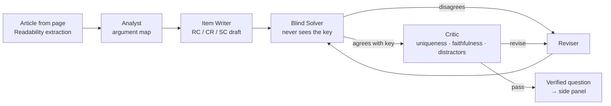

# Questionize

**Turn the article you're reading into verified GMAT/LSAT-style reasoning questions — powered by Meta's Muse models.**

Questionize is a Chrome extension. Open any news story, essay or blog post, click the toolbar button, and a side panel builds exam-quality Reading Comprehension, Critical Reasoning and Sentence Correction questions from that exact text. Answer, then get the key, an explanation of every option, and a one-click jump to the sentence in the article the question rests on.

> Built for the **Meta Global AI Developer Hackathon** (Oct 27 – Nov 4, 2026) · Theme: *Build for Your World* · Everything in this repository was written during the hackathon.

## Why

Verbal reasoning prep lives in question banks that feel nothing like what people actually read. Meanwhile people read arguments all day — op-eds, earnings coverage, policy news — without practicing the skills tests measure: spotting the assumption, the flaw, the alternative cause. Questionize turns that daily reading into deliberate practice.

The hard part is quality. A single "write me an LSAT question" prompt produces items with two defensible answers or giveaway distractors. So questions here pass through a **multi-agent verification loop** before you see them.

## How it works



| Agent | Job |
|---|---|
| **Analyst** | Separates conclusions from premises, lists unstated assumptions and real flaws, picks RC focus points and SC-worthy sentences. |
| **Item Writer** | Writes one five-option item per slot in official GMAT/LSAT stem style, with a rationale for every option and a verbatim anchor phrase from the article. |
| **Blind Solver** | Solves the item from the passage alone. It never sees the intended answer or explanation. |
| **Critic** | Confirms exactly one defensible answer, nothing invented about the source, distractor quality ≥ 3/5. |
| **Reviser** | Rewrites the item using the solver's reasoning and the critic's guidance (up to `MAX_REVISIONS`). |

A question is marked **✓ Verified** only when the blind solver independently reaches the keyed answer *and* the critic passes it. Slots run in parallel, and every agent step streams to the side panel live.

**Cross-model verification:** set `SOLVER_PROVIDER=baseten` to have **Muse Spark Open** (open weights, `meta-models/muse-spark-open-1026`) solve items written by **Muse Spark 1.3** on the Meta Model API — two different models must agree before a question ships.

## Repository layout

```
extension/          Chrome extension (Manifest V3, Vue 3 + TypeScript, built with Vite into dist/)
  src/background.ts   toolbar + right-click "Questionize this passage"
  src/sidepanel/      side panel: live agent log, question cards, answers through the Rails API
  src/page-tools.ts   page extraction (Readability) and in-article highlighting
  public/vendor/      Mozilla Readability (Apache-2.0)
api/                Rails 8 API: users, question bank, attempts and ratings, knowledge model, jobs, Action Cable
web/                Vue 3 web app (served by Rails in production): installable app with three tabs: Snap (camera → Miss Lab analysis → practice on the same trap), Questions (My misses and the shared bank) and Me (Analysis and Stats); share pages
ai/                 FastAPI AI service with the agent pipeline (internal only)
  questionize/
    pipeline.py       Analyst → Writer → Solver → Critic → Argument Judge → Reviser loop
    judge.py          Argument Judge: per-option measurements with uncertainty
    prompts.py        agent instructions
    schemas.py        structured-output contracts (Pydantic → JSON Schema)
    llm.py            clients: OpenAI-compatible (Meta Model API / Baseten) and Anthropic
    errorlog.py       error log: diagnose one photographed question, write practice on the same trap
    app.py            /health and the token-guarded /v1 endpoints (generate, judge, map, review, diagnose)
  eval/               gold-set format for scoring the Argument Judge
  tests/              offline tests with scripted models
packages/shared/    TypeScript types, API client, Action Cable helpers and shared Vue components
docs/               architecture, knowledge model, deployment
```

## Run it locally

**1. AI service**

```bash
cd ai
python -m venv .venv && source .venv/bin/activate
pip install -r requirements.txt
cp .env.example .env           # set INTERNAL_TOKEN and a provider key (MODEL_API_KEY by default)
uvicorn questionize.app:app --reload --port 8000
```

Check it: `curl localhost:8000/health`

**2. Rails API** (needs PostgreSQL)

```bash
cd api
bin/setup --skip-server
AI_SERVICE_URL=http://localhost:8000 AI_INTERNAL_TOKEN=<same as ai/.env INTERNAL_TOKEN> bin/rails server
```

**3. Extension**

```bash
pnpm install
pnpm --filter @questionize/extension build    # or: pnpm --filter @questionize/extension dev (rebuilds on change)
```

1. Open `chrome://extensions`, turn on **Developer mode**.
2. **Load unpacked** → select the `extension/dist/` folder.
3. Pin Questionize, open an article, click the icon.

The side panel talks to `https://questionize.org` by default. For local development, open ⚙ Settings and set the server to `http://localhost:3000`. The panel registers an anonymous device on first use; it never talks to the AI service directly.

You can also highlight a paragraph, right-click, and choose **Questionize this passage** to focus questions there.

**Tests**

```bash
cd ai && pip install -r requirements-dev.txt && pytest
cd api && bin/rails test
pnpm install && pnpm -r test
```

## Configuration

See [`ai/.env.example`](ai/.env.example). Key settings:

| Variable | Default | Purpose |
|---|---|---|
| `INTERNAL_TOKEN` | — | Shared secret required in `X-Internal-Token` on every `/v1` request |
| `LLM_PROVIDER` | `meta` | Provider for Analyst, Writer, Critic (`meta`, `baseten` or `anthropic`) |
| `SOLVER_PROVIDER` | same as above | Provider for the Blind Solver — set differently for cross-model checks |
| `SOLVER_MODEL` | provider default | Model override for the Blind Solver |
| `ANTHROPIC_MODEL` | `claude-sonnet-5-5` | Claude model ID |
| `META_MODEL` | `muse-spark-1.3` | Meta Model API model ID |
| `BASETEN_MODEL` | `meta-models/muse-spark-open-1026` | Muse Spark Open on Baseten |
| `MAX_REVISIONS` | `2` | Revision rounds before an item ships as unverified |

## Roadmap

- Logic games (analytical reasoning) whose rules are compiled to code, so a program enumerates every valid arrangement and proves the keyed answer is the only one

- Adaptive difficulty from per-skill accuracy (stats are already tracked per sub-type)
- Quant: data-sufficiency and problem-solving items from numbers in financial and science articles
- Spaced review of missed items

## License

- **Code:** MIT (`LICENSE`).
- **Questions and the knowledge model's descriptive content:** CC BY-NC-SA 4.0 from October 29, 2026, to the extent they are protected; free to share and adapt for non-commercial use with attribution. Content published earlier remains under CC BY-SA 4.0. Commercial licenses are available from Keefit, Inc.
- **Data:** answer statistics, difficulty calibration, Argument Judge measurements and learner analytics are not openly licensed.
- Mozilla Readability is included under Apache-2.0 (`extension/public/vendor/Readability.LICENSE.md`).

The service at questionize.org is operated by Keefit, Inc. ([Terms](https://questionize.org/terms), [Privacy](https://questionize.org/privacy)).
