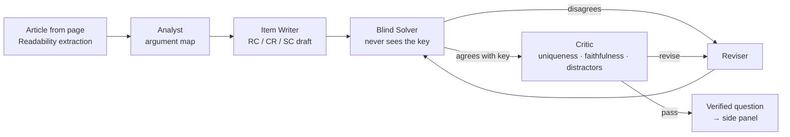

# Questionize

**Turn the article you're reading into verified GMAT/LSAT-style reasoning questions — powered by Meta's Muse models.**

Questionize is a Chrome extension. Open any news story, essay or blog post, click the toolbar button, and a side panel builds exam-quality Reading Comprehension, Critical Reasoning and Sentence Correction questions from that exact text. Answer, then get the key, an explanation of every option, and a one-click jump to the sentence in the article the question rests on.

> Built for the **Meta Global AI Developer Hackathon** (Oct 27 – Nov 4, 2026) · Theme: *Build for Your World* · Everything in this repository was written during the hackathon.

## Why

Verbal reasoning prep lives in question banks that feel nothing like what people actually read. Meanwhile people read arguments all day — op-eds, earnings coverage, policy news — without practicing the skills tests measure: spotting the assumption, the flaw, the alternative cause. Questionize turns that daily reading into deliberate practice.

The hard part is quality. A single "write me an LSAT question" prompt produces items with two defensible answers or giveaway distractors. So questions here pass through a **multi-agent verification loop** before you see them.

## How it works



| Agent | Job |
|---|---|
| **Analyst** | Separates conclusions from premises, lists unstated assumptions and real flaws, picks RC focus points and SC-worthy sentences. |
| **Item Writer** | Writes one five-option item per slot in official GMAT/LSAT stem style, with a rationale for every option and a verbatim anchor phrase from the article. |
| **Blind Solver** | Solves the item from the passage alone. It never sees the intended answer or explanation. |
| **Critic** | Confirms exactly one defensible answer, nothing invented about the source, distractor quality ≥ 3/5. |
| **Reviser** | Rewrites the item using the solver's reasoning and the critic's guidance (up to `MAX_REVISIONS`). |

A question is marked **✓ Verified** only when the blind solver independently reaches the keyed answer *and* the critic passes it. Slots run in parallel, and every agent step streams to the side panel live.

**Cross-model verification:** set `SOLVER_PROVIDER=baseten` to have **Muse Spark Open** (open weights, `meta-models/muse-spark-open-1026`) solve items written by **Muse Spark 1.3** on the Meta Model API — two different models must agree before a question ships.

## Repository layout

```
extension/          Chrome extension (Manifest V3, no build step)
  background.js       toolbar + right-click "Questionize this passage"
  sidepanel/          study UI: settings, live agent log, question cards, stats
  content/            page extraction (Readability) and in-article highlighting
  vendor/             Mozilla Readability (Apache-2.0)
server/             FastAPI backend with the agent pipeline
  questionize/
    pipeline.py       Analyst → Writer → Solver → Critic → Reviser loop
    prompts.py        agent instructions
    schemas.py        structured-output contracts (Pydantic → JSON Schema)
    llm.py            OpenAI-compatible client for Meta Model API / Baseten
    app.py            /api/questions and NDJSON streaming endpoint
  tests/              offline tests with a scripted model
```

## Run it locally

**1. Server**

```bash
cd server
python -m venv .venv && source .venv/bin/activate
pip install -r requirements.txt
cp ../.env.example .env        # then paste your MODEL_API_KEY
uvicorn questionize.app:app --reload --port 8000
```

Check it: `curl localhost:8000/health`

**2. Extension**

1. Open `chrome://extensions`, turn on **Developer mode**.
2. **Load unpacked** → select the `extension/` folder.
3. Pin Questionize, open an article, click the icon.

The side panel talks to `http://localhost:8000` by default; change it under ⚙ Settings.

You can also highlight a paragraph, right-click, and choose **Questionize this passage** to focus questions there.

**Tests**

```bash
cd server && pip install -r requirements-dev.txt && pytest
```

## Configuration

See [`.env.example`](.env.example). Key settings:

| Variable | Default | Purpose |
|---|---|---|
| `LLM_PROVIDER` | `meta` | Provider for Analyst, Writer, Critic (`meta` or `baseten`) |
| `SOLVER_PROVIDER` | same as above | Provider for the Blind Solver — set differently for cross-model checks |
| `META_MODEL` | `muse-spark-1.3` | Meta Model API model ID |
| `BASETEN_MODEL` | `meta-models/muse-spark-open-1026` | Muse Spark Open on Baseten |
| `MAX_REVISIONS` | `2` | Revision rounds before an item ships as unverified |

## Roadmap

- Adaptive difficulty from per-skill accuracy (stats are already tracked per sub-type)
- Quant: data-sufficiency and problem-solving items from numbers in financial and science articles
- Spaced review of missed items

## License

MIT. Mozilla Readability is included under Apache-2.0 (`extension/vendor/Readability.LICENSE.md`).
