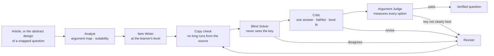

# Questionize

**Snap a question you missed. See what it tests, why your answer was tempting, and practice the same trap — with reasoning questions verified by Meta's Muse models.**

Questionize is a reasoning tutor for Critical Reasoning and Reading Comprehension, from Grades 3–5 up to the GMAT, LSAT and GRE. It is an installable web app at [questionize.org](https://questionize.org) and a Chrome extension.

> Built for the **Meta Global AI Developer Hackathon** (Oct 27 – Nov 4, 2026) · Theme: *Build for Your World* · Everything in this repository was written during the hackathon.

## What it does

- **Snap** (the app opens on the camera). Photograph a question you got wrong in your own workbook and crop it to the passage, question and options (a question across two pages can be sent as up to three parts). **Miss Lab** reads it live and returns:
  - the question itself, saved **only on your device**, so you can solve it again;
  - its difficulty (1–5), what the question writer set out to test, and the skills to practice;
  - why your answer was tempting: the trap it set and the belief behind your choice;
  - every option explained, in our own words;
  - new practice questions on different topics that set the same trap. Once verified they join the shared bank for everyone, and the same design is re-pitched in the background for other levels (Grades 6–8, 9–12, College by default), so one GMAT miss also stocks the school levels.

  Photos are read once and deleted; the server keeps no copy of the book's text.
- **Questions.** *My misses* collects the questions you snapped and the bank questions you missed, with previous / next and swipe between Question, Analysis and Practice; *Bank* is the shared, rated question bank with **For you** picks; *Archived* holds what you've mastered.
- **Me.** *Analysis* shows the traps that catch you, the misconceptions behind them, the question types you miss and what to practice next; *Stats* shows ratings by skill. Choose your **level** here (Grades 3–5, 6–8, 9–12 · SAT/ACT, College & adult, GMAT, LSAT, GRE); everything written for you follows it. Sign in with **Facebook** to keep it on every device.
- **Chrome extension.** On any article: *Map & challenge* reconstructs the argument (conclusion, premises, the assumption it leans on most) and asks three critical questions; *Practice questions* turns the article into verified questions; *My misses* works like Snap.
- **Share** any bank question to Facebook, Threads, WhatsApp or X, or to Instagram as an image card. The answer is never in the preview.

## How questions are made and checked



| Agent | Job |
|---|---|
| **Analyst** | Separates conclusions from premises, lists unstated assumptions and real flaws, and declines pages that aren't suitable (too thin, exam material, harmful content). |
| **Item Writer** | Writes one five-option question per slot for the learner's level, with a rationale and a trap tag for every option. |
| **Blind Solver** | Solves the item from the passage alone; it never sees the key. |
| **Critic** | Confirms exactly one defensible answer, nothing invented about the source, tempting distractors, and language that fits the level. |
| **Argument Judge** | Rates, for every option, how much it would move the conclusion if true and how much the argument needs it, with bootstrap uncertainty. The key must come first in ≥ 90% of resamples by a clear margin. |
| **Reviser** | Rewrites the item from the solver's reasoning, the critic's and the judge's findings. |

After publication, learners' answers, votes and reports keep checking each question: reports or crowd disagreement trigger an automatic re-review that can keep, revise or retire it.

**Levels.** `ai/questionize/levels.py` turns the learner's level into an audience brief (language, passage length, skills in scope, distractor style, explanation voice, the Common Core RI.x.8 standard for school grades) used by every writing and checking step. See [`docs/LEARNING_MODEL.md`](docs/LEARNING_MODEL.md) for how learners are assessed, how recommendations work, and how quality is measured.

**Cross-model verification:** set `SOLVER_PROVIDER=baseten` to have **Muse Spark Open** (open weights, `meta-models/muse-spark-open-1026`) solve items written by **Muse Spark 1.3** on the Meta Model API.

## Repository layout

```
extension/          Chrome extension (Manifest V3, Vue 3 + TypeScript, built with Vite into dist/)
  src/background.ts   toolbar + right-click "Questionize this passage"
  src/sidepanel/      side panel: live agent log, question cards, answers through the Rails API
  src/page-tools.ts   page extraction (Readability) and in-article highlighting
  public/vendor/      Mozilla Readability (Apache-2.0)
api/                Rails 8 API: users, question bank, attempts and ratings, knowledge model, jobs, Action Cable
web/                Vue 3 web app (served by Rails in production): installable app with three tabs: Snap (camera → Miss Lab analysis → practice on the same trap), Questions (My misses and the shared bank) and Me (Analysis and Stats); share pages
ai/                 FastAPI AI service with the agent pipeline (internal only)
  questionize/
    pipeline.py       Analyst → Writer → Solver → Critic → Argument Judge → Reviser loop
    judge.py          Argument Judge: per-option measurements with uncertainty
    prompts.py        agent instructions
    schemas.py        structured-output contracts (Pydantic → JSON Schema)
    llm.py            clients: OpenAI-compatible (Meta Model API / Baseten) and Anthropic
    errorlog.py       Snap: read a photographed question, diagnose it, write practice on the same trap
    levels.py         learner levels: the audience brief every writing and checking step receives
    app.py            /health and the token-guarded /v1 endpoints (generate, judge, map, review, diagnose)
  eval/               gold-set format for scoring the Argument Judge
  tests/              offline tests with scripted models
packages/shared/    TypeScript types, API client, Action Cable helpers and shared Vue components
docs/               architecture, knowledge model, learning model (assessment, levels, quality), deployment
```

## Run it locally

**1. AI service**

```bash
cd ai
python -m venv .venv && source .venv/bin/activate
pip install -r requirements.txt
cp .env.example .env           # set INTERNAL_TOKEN and a provider key (MODEL_API_KEY by default)
uvicorn questionize.app:app --reload --port 8000
```

Check it: `curl localhost:8000/health`

**2. Rails API** (needs PostgreSQL)

```bash
cd api
bin/setup --skip-server
AI_SERVICE_URL=http://localhost:8000 AI_INTERNAL_TOKEN=<same as ai/.env INTERNAL_TOKEN> bin/rails server
```

**3. Web app**

```bash
pnpm install
pnpm --filter @questionize/web dev       # http://localhost:5173, proxied to Rails on :3000
```

**4. Extension**

```bash
pnpm install
pnpm --filter @questionize/extension build    # or: pnpm --filter @questionize/extension dev (rebuilds on change)
```

1. Open `chrome://extensions`, turn on **Developer mode**.
2. **Load unpacked** → select the `extension/dist/` folder.
3. Pin Questionize, open an article, click the icon.

The side panel talks to `https://questionize.org` by default. For local development, open ⚙ Settings and set the server to `http://localhost:3000`. The panel registers an anonymous device on first use; it never talks to the AI service directly.

You can also highlight a paragraph, right-click, and choose **Questionize this passage** to focus questions there.

**Tests**

```bash
cd ai && pip install -r requirements-dev.txt && pytest
cd api && bin/rails test
pnpm install && pnpm -r test
```

## Configuration

See [`ai/.env.example`](ai/.env.example). Key settings:

| Variable | Default | Purpose |
|---|---|---|
| `INTERNAL_TOKEN` | — | Shared secret required in `X-Internal-Token` on every `/v1` request |
| `LLM_PROVIDER` | `meta` | Provider for Analyst, Writer, Critic (`meta`, `baseten` or `anthropic`) |
| `SOLVER_PROVIDER` | same as above | Provider for the Blind Solver — set differently for cross-model checks |
| `SOLVER_MODEL` | provider default | Model override for the Blind Solver |
| `ANTHROPIC_MODEL` | `claude-sonnet-5-5` | Claude model ID |
| `META_MODEL` | `muse-spark-1.3` | Meta Model API model ID |
| `BASETEN_MODEL` | `meta-models/muse-spark-open-1026` | Muse Spark Open on Baseten |
| `MAX_REVISIONS` | `2` | Revision rounds before an item ships as unverified |

Rails settings (database, AI service URL and token, Facebook Login app id and secret) are listed in [`api/.env.example`](api/.env.example); deployment is described in [`docs/DEPLOY.md`](docs/DEPLOY.md).

## Roadmap

- Spaced review of missed questions and mastery per skill ([`docs/LEARNING_MODEL.md`](docs/LEARNING_MODEL.md) §3, §5)
- Three-option questions for Grades 3–5 and four-option SAT-style questions
- Item statistics and Argument Judge gold-set reports
- Teacher and parent accounts (needed before children under 13 can have their own)
- More subjects through the same Snap flow: math, then sciences
- Logic games whose rules are compiled to code, so a program proves the keyed answer is the only one

## License

- **Code:** MIT (`LICENSE`).
- **Questions and the knowledge model's descriptive content:** CC BY-NC-SA 4.0 from October 29, 2026, to the extent they are protected; free to share and adapt for non-commercial use with attribution. Content published earlier remains under CC BY-SA 4.0. Commercial licenses are available from Keefit, Inc.
- **Data:** answer statistics, difficulty calibration, Argument Judge measurements and learner analytics are not openly licensed.
- Mozilla Readability is included under Apache-2.0 (`extension/public/vendor/Readability.LICENSE.md`).

The service at questionize.org is operated by Keefit, Inc. ([Terms](https://questionize.org/terms), [Privacy](https://questionize.org/privacy)).
