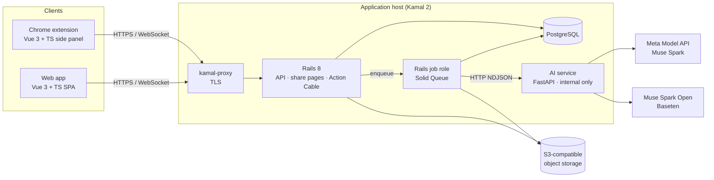
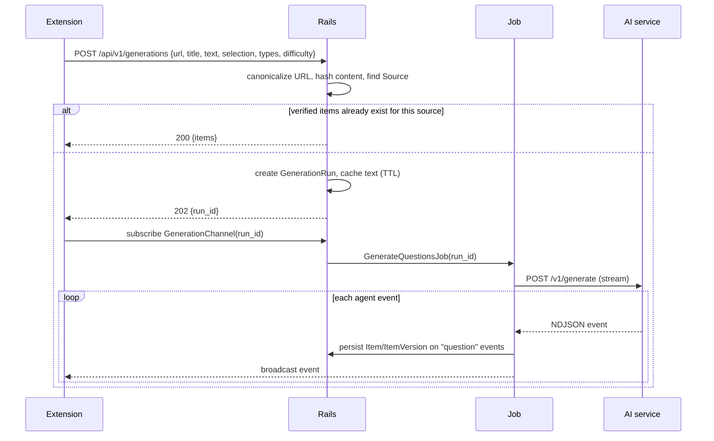
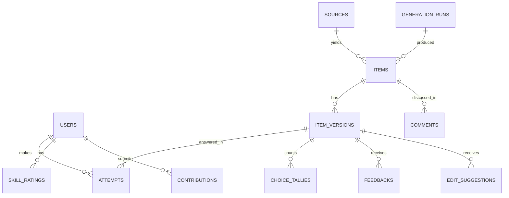

# Questionize — Architecture

Questionize turns the articles people read into exam-style reasoning questions (GMAT/LSAT-style Reading Comprehension, Critical Reasoning, Sentence Correction), verifies them with a multi-agent pipeline, and collects them in an open, community-improved question bank.

The knowledge the bank is built on (competencies, misconceptions, trap patterns, blueprints, evidence) is specified in [`KNOWLEDGE_MODEL.md`](KNOWLEDGE_MODEL.md); questions are generated from it.

This document describes the **target architecture**. The current code (`extension/` + `ai/`) is the first prototype; the migration plan is at the end.

## 1. Product capabilities

| Capability | Summary |
|---|---|
| Generate | From the page a reader is on, generate and verify questions (Analyst → Writer → Blind Solver → Critic → Reviser). |
| Shared bank | Every verified question is stored once and served to anyone who opens the same article or browses the bank. |
| Diagnose | Each attempt updates a per-skill rating for the user and a difficulty rating for the item (Elo-style). Users see absolute ratings and per-skill percentile rankings. |
| Crowd answers | After answering, users see how everyone else answered (A 12% · B 8% · C 61% …), like a poll that unlocks after voting. |
| Share | Every question has a public page with a social preview card so it can be posted and solved in the comments. |
| Improve | Users rate items, flag problems (wrong key, two defensible answers, typo) and suggest edits. Signals trigger an automatic re-review that produces a new item version. |
| Contribute | Users contribute their own questions, or a photo from which only an abstract reasoning pattern is extracted to seed a brand-new original item. |

## 2. System overview



**Principles**

- **Rails owns all state.** The AI service is stateless: it receives text, returns structured results, and never touches the database. This keeps model experimentation isolated from product logic.
- **Long work runs in jobs, progress is pushed.** Generation takes 20–90 s. Rails enqueues a job, the job streams events from the AI service and rebroadcasts them over Action Cable. The client can close the panel; questions are still saved.
- **No Redis.** Rails 8's Solid Queue, Solid Cache and Solid Cable all run on PostgreSQL, so the stack is Rails + Postgres + the AI container.
- **One deploy unit for the web.** The Vue web app is built in a Docker stage and served from the Rails image, so share pages and the SPA ship together.

## 3. Repository layout (target)

```
ai/                 FastAPI AI service
api/                Rails 8 app: API, share pages, jobs, channels, Kamal config
  config/deploy.yml   Kamal 2 configuration
web/                Vue 3 + TypeScript + Vite web app
extension/          Chrome extension, side panel in Vue 3 + TypeScript + Vite
packages/shared/    TS API client, shared types, shared Vue components
                    (QuestionCard, ChoiceDistribution, RatingBadge)
docs/
pnpm-workspace.yaml web, extension, packages/*
```

`web/` and `extension/` share `packages/shared` so a question renders identically in the side panel, on the web, and on share pages.

## 4. Components

### 4.1 Rails 8 (`api/`)

- **Mode:** full Rails (not `--api`), because it renders public share pages with meta tags. All app UI is Vue; Rails views are limited to share-page shells and the SPA entry.
- **Auth:**
  - Web: Rails 8 authentication generator (session cookies); email magic-link sign-in.
  - Extension: on first launch it calls `POST /api/v1/devices` and receives an anonymous user plus a bearer token (`has_secure_token`). An anonymous user can later be claimed by signing in on the web, which merges history.
- **Background jobs (Solid Queue):** `GenerateQuestionsJob`, `ReviewItemJob`, `ProcessContributionJob`, `RenderShareImageJob`, `RecomputeLeaderboardsJob`.
- **Realtime (Action Cable on Solid Cable):** `GenerationChannel` (agent progress per run), `ItemChannel` (live answer tallies).
- **Rate limiting:** Rails `rate_limit` on generation and contribution endpoints; per-user daily generation quota.
- **Caching:** Solid Cache for article text in flight (TTL 1 h) and for bank lookups by source.

### 4.2 AI service (`ai/`)

Stateless FastAPI app reachable only on the private Docker network. Every request carries an `X-Internal-Token` header shared with Rails.

| Endpoint | Purpose |
|---|---|
| `POST /v1/generate` | Article → verified questions. NDJSON event stream (existing pipeline). |
| `POST /v1/review` | Item version + flags/suggestions/crowd stats → critic verdict and, if needed, a revised version. |
| `POST /v1/extract-pattern` | Image or text → abstract reasoning pattern (family, sub-type, flaw/assumption type, distractor traps, difficulty cues). Returns no verbatim text. |
| `POST /v1/generate-from-pattern` | Pattern (+ optional article) → new original item, verified through the same loop. |
| `GET /health` | Liveness and configured models. |

Model routing stays configurable (`LLM_PROVIDER`, `SOLVER_PROVIDER`, `SOLVER_MODEL`; Claude is available as a development provider): Muse Spark on the Meta Model API for analysis, writing and critique; the blind solver can run on a different model (Muse Spark Open on Baseten) so two independent models must agree before an item ships.

### 4.3 Web app (`web/`)

Vue 3, TypeScript, Vite, Vue Router, Pinia, `@rails/actioncable`.

Routes: `/` (practice feed), `/q/:publicId` (question), `/s/:sourceId` (questions from one article), `/me` (ratings by skill, history, XP), `/leaderboard/:skill`, `/contribute`, `/review` (community review queue).

### 4.4 Chrome extension (`extension/`)

Manifest V3, side panel built with Vite (multi-entry: side panel, service worker). Extraction (Readability) and in-article highlighting stay as injected functions. It talks only to Rails, never to the AI service.

## 5. Key flows

### 5.1 Generate from an article



Article text is used only in flight (cache + job) and is not stored in permanent tables. Sources are stored as metadata (canonical URL, title, domain, content hash).

### 5.2 Answer an item

`POST /api/v1/items/:id/attempts {label, time_ms}` runs in one transaction:

1. Insert the attempt. Only a user's **first** attempt on an item is rated.
2. Increment the per-label tally for the item version.
3. Update the user's skill rating and the item's rating (5.3).
4. Award XP.
5. Return the key, explanation, per-option rationales, answer distribution and rating change, then broadcast the new tally on `ItemChannel`.

Before a user has answered, `GET /api/v1/items/:id` omits the key, explanations and tallies.

### 5.3 Ratings (diagnosis)

Elo-style rating with uncertainty-aware step sizes; upgrade path to Glicko-2.

- Skill = `family:subtype` (e.g. `CR:assumption`). Users also get a family rating (RC/CR/SC) and an overall rating, computed from the same updates.
- Item start rating by difficulty label: easy 1300, medium 1500, hard 1700.
- Expected score `E = 1 / (1 + 10^((R_item − R_user) / 400))`; result `S` is 1 or 0.
- `R_user += K_user · (S − E)`, `R_item −= K_item · (S − E)`.
- `K_user` = 40 for the first 20 rated attempts in that skill, then 24, then 16 after 100. `K_item` = 32 until 30 attempts, then 12.
- **Absolute view:** rating with a confidence band per skill. **Relative view:** percentile among users with ≥ 10 rated attempts in that skill. Ratings are an internal scale and are not presented as official test scores.

Every distractor carries a `trap` tag (out of scope, too extreme, reversal, half right, unsupported, irrelevant, distortion; for SC, grammar error or changes meaning), so wrong answers also build a per-user profile of the traps they fall for.

XP is separate from rating and rewards participation: answering, answering hard items correctly, accepted edit suggestions, verified contributions.

### 5.4 Quality loop

Item status: `verified → flagged → under_review → verified (new version) | retired`.

Re-review triggers (`ReviewItemJob` → `POST /v1/review`):

- ≥ 3 flags with the same reason, or any flag from a high-rated user in that skill.
- **Crowd disagreement:** ≥ 20 rated attempts, and among users rated above the item, the most chosen option is not the key and holds > 45 %.
- An edit suggestion with ≥ 3 upvotes.

A review produces a new `ItemVersion`. Attempts stay linked to the version they answered; tallies and item rating carry over only when the key is unchanged.

### 5.5 Contributions

- **Own questions:** submitted text runs through the same verification loop; on success it enters the bank credited to the contributor.
- **Photo → pattern:** the image is held only in memory (or a temp object with a 1-day lifecycle rule), sent to `/v1/extract-pattern`, and discarded. Only the abstract pattern JSON is stored, and `/v1/generate-from-pattern` writes a new original item from it. No uploaded image or its verbatim text is stored or published.

### 5.6 Share pages

`GET /q/:publicId` is rendered by Rails with Open Graph / Twitter card tags (stem preview, family, "x % answered correctly"), then mounts the Vue question component. The card image is rendered from an SVG template by `RenderShareImageJob` (ruby-vips) and cached in object storage.

## 6. Data model

The tables below cover users, items and activity. Knowledge-model tables are listed in [`KNOWLEDGE_MODEL.md` §7](KNOWLEDGE_MODEL.md#7-storage-postgresql-owned-by-rails).



| Table | Key columns |
|---|---|
| `users` | `handle`, `email` (nullable), `anonymous`, `xp`, `api_token` |
| `sources` | `canonical_url` (unique), `title`, `domain`, `content_hash` |
| `generation_runs` | `user_id`, `source_id`, `params` jsonb, `status`, `events` jsonb, `token_usage` jsonb |
| `items` | `public_id`, `source_id`, `family`, `subtype`, `status`, `current_version_id`, `rating`, `attempts_count`, `correct_count`, `origin` (generated / contributed / pattern) |
| `item_versions` | `item_id`, `version`, `passage`, `stem`, `choices` jsonb, `correct_label`, `explanation`, `rationales` jsonb, `skill`, `source_anchor`, `verification` jsonb, `author_kind` (agent / user), `parent_version_id` |
| `attempts` | `user_id`, `item_version_id`, `chosen_label`, `correct`, `time_ms`, `rated`, rating before/after (user and item) — unique index on `(user_id, item_id)` where `rated` |
| `choice_tallies` | `item_version_id`, `label`, `count` |
| `skill_ratings` | `user_id`, `skill`, `rating`, `attempts`, `correct` |
| `feedbacks` | `user_id`, `item_version_id`, `kind` (up / down / flag), `reason`, `comment` |
| `edit_suggestions` | `user_id`, `item_version_id`, `field`, `proposal` jsonb, `status`, `votes` |
| `comments` | `user_id`, `item_id`, `body`, `parent_id` |
| `contributions` | `user_id`, `kind` (own_item / photo_pattern), `status`, `pattern` jsonb, `item_id` |

## 7. Content policy (built into the pipeline)

- Shared items use **adapted** RC passages (rewritten, with a link to the source) rather than long verbatim excerpts; `source_anchor` is a short phrase used only for in-page highlighting.
- The AI service enforces this: a passage that shares more than `MAX_COPIED_WORDS` (default 12) consecutive words with the article is sent back for a rewrite before the solver runs, and `verification.copied_words` records the longest shared run.
- The analyst tags sensitive subject matter (`content_flags`: sexual violence, self-harm, graphic violence, harm to minors, hate or harassment, explicit sexual content). Flagged items stay out of the public feed until reviewed.
- Uploaded images are never stored or published (5.5).
- Recalled or leaked live-exam content is not accepted.
- Question-bank data is published under **CC BY-SA 4.0**; code under MIT.

## 8. Deployment (Kamal 2)

Initial footprint is a single cloud server; the layout lets the database move to its own server later.

| Kamal unit | Image | Notes |
|---|---|---|
| `web` role | Rails image (includes built Vue app) | Behind kamal-proxy with Let's Encrypt TLS; health check `/up`. |
| `job` role | same Rails image | `bin/jobs` (Solid Queue). |
| `db` accessory | `postgres:17` | Persistent volume; daily `pg_dump` to S3-compatible object storage. |
| `ai` accessory | AI service image | No public port; reached by Rails at `http://<service>-ai:8000` on the `kamal` Docker network. |

- Images build from the repo root (`api/Dockerfile` has a Node stage that builds `web/`). Registry: GHCR.
- Secrets come from `.kamal/secrets` reading environment variables / a password manager; nothing secret is committed.
- Scale-out path: move Postgres to a dedicated server on a private network, add web hosts behind kamal-proxy, run more job hosts.

## 9. Testing and CI

- Rails: Minitest (models, rating math, request specs for attempt/visibility rules).
- AI service: pytest with a scripted model (no network).
- Web/extension: Vitest + Vue Test Utils.
- GitHub Actions: run all suites on PRs; build and push images on `main`.

## 10. Migration from the prototype

1. ~~Move `server/` → `ai/`; add `X-Internal-Token` auth and the `/v1/*` routes.~~ Done for `/v1/generate`; `/v1/review` and the pattern routes follow with their features.
2. Create the Rails app in `api/` with the schema above; implement devices, generations, items, attempts.
3. Rebuild the side panel in Vue against Rails instead of the AI service.
4. Add the web app, share pages, quality loop and contributions.
